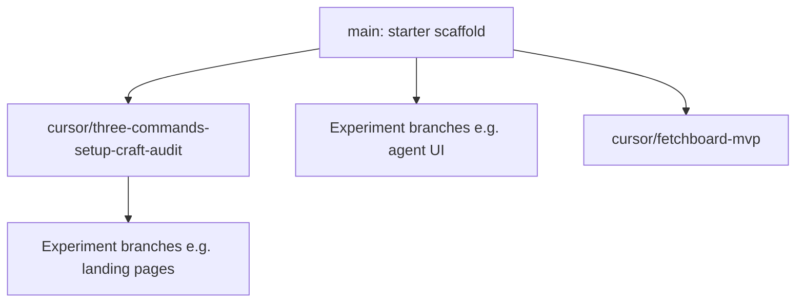

# cursor-lab

A shared [Next.js](https://nextjs.org) sandbox for **Cursor-driven experiments**: UI prototypes, marketing landings, agent-panel studies, and tooling spikes. **`main` is the neutral baseline**—the default create-next-app starter—not a shipping product. Each idea lives on its own branch (usually with an open PR).

## How this lab is used

1. **Branch** from `main`, or from another experiment branch when you want a stacked base. Name branches `cursor/<short-description>-<suffix>` (for example `cursor/harbor-landing-page-2ea0`).
2. **Build** the experiment on that branch and keep the diff scoped to one idea.
3. **Open a PR** (draft is fine). The PR description is the experiment’s narrative: assumptions, verification, screenshots.
4. **Run an experiment locally:**

   ```bash
   git fetch origin
   git checkout <branch-name>
   npm install
   npm run dev
   ```

   Open [http://localhost:3000](http://localhost:3000). Use the checked-out branch’s `package.json` for any extra scripts (tests, setup skills, and so on).

5. **`main` stays merge-light** so new experiments always start from a clean scaffold. Merge only when an experiment should become the new default.

### Stacked bases

Some work stacks on top of the setup branch instead of `main`:

- [**PR #8**](https://github.com/kdjadeja21/cursor-lab/pull/8) — branch `cursor/three-commands-setup-craft-audit-cf6a`: `.cursor/` setup, `/craft`, and `/audit` commands.
- **PRs #9–#11** use that branch as their base so they share shadcn and craft tooling without changing `main`.

When checking out an experiment, read the PR’s **base branch** on GitHub so you pull the right stack.



## Experiments in this repo

These branches and PRs exist today (descriptions are high level; see each PR for detail):

| Experiment | Branch (checkout) | PR | What it is |
|------------|-------------------|-----|------------|
| Agent window UI studies | `cursor/agent-window-redesign-*` (several iterations) | [#1](https://github.com/kdjadeja21/cursor-lab/pull/1)–[#4](https://github.com/kdjadeja21/cursor-lab/pull/4) | Frontend-only Cursor agent panel prototypes |
| Fetchboard MVP | `cursor/fetchboard-mvp-e3f7` | [#5](https://github.com/kdjadeja21/cursor-lab/pull/5) | No-code REST/GraphQL dashboard builder; see that branch’s README for full docs |
| Slotly / Cal-style landing | `cursor/landing-page-1bc7`, `cursor/slotly-5-landing-page-c841` | [#6](https://github.com/kdjadeja21/cursor-lab/pull/6), [#9](https://github.com/kdjadeja21/cursor-lab/pull/9) | Marketing / scheduling landing pages (shadcn) |
| Harbor landing | `cursor/harbor-landing-page-2ea0` | [#7](https://github.com/kdjadeja21/cursor-lab/pull/7) | Workspace product marketing page |
| Setup / craft / audit | `cursor/three-commands-setup-craft-audit-cf6a` | [#8](https://github.com/kdjadeja21/cursor-lab/pull/8) | Cursor commands and vendored skills wiring |
| Grok Bot landing | `cursor/grok-bot-landing-4616` | [#10](https://github.com/kdjadeja21/cursor-lab/pull/10) | Recreation of the x.ai/bot landing (base: setup branch) |
| Interest calculator | `cursor/interest-calculator-103c` | [#11](https://github.com/kdjadeja21/cursor-lab/pull/11) | `/interest-calculator` fintech dashboard (base: setup branch) |

Full list: [pull requests](https://github.com/kdjadeja21/cursor-lab/pulls) on GitHub.

## Tech stack on `main`

Versions are pinned in [`package.json`](package.json).

- Next.js 16 (App Router)
- React 19
- TypeScript
- Tailwind CSS v4 (`@tailwindcss/postcss`)
- ESLint (`eslint-config-next`)
- Geist and Geist Mono via `next/font`

Experiment branches often add shadcn/ui, extra routes, tests, or `.cursor/` config—always install and run scripts from the branch you have checked out.

## Project structure (`main`)

```text
app/                 # App Router layout and pages (entry: app/page.tsx)
public/              # Static assets
next.config.ts
postcss.config.mjs
eslint.config.mjs
tsconfig.json
```

Branches typically grow `components/`, `lib/`, `app/<routes>/`, and other paths as needed.

## Prerequisites

Node.js 20 or newer.

## Commands (`main`)

```bash
npm install
npm run dev      # development server at http://localhost:3000
npm run build    # production build
npm run start    # serve production build
npm run lint     # ESLint
```

## Deploy

Any branch that passes `npm run build` can deploy like a normal Next.js app (for example on [Vercel](https://vercel.com)). In this lab, experiments are usually previewed locally or via PR previews—not treated as production releases.

## Reference

- [Next.js documentation](https://nextjs.org/docs)
